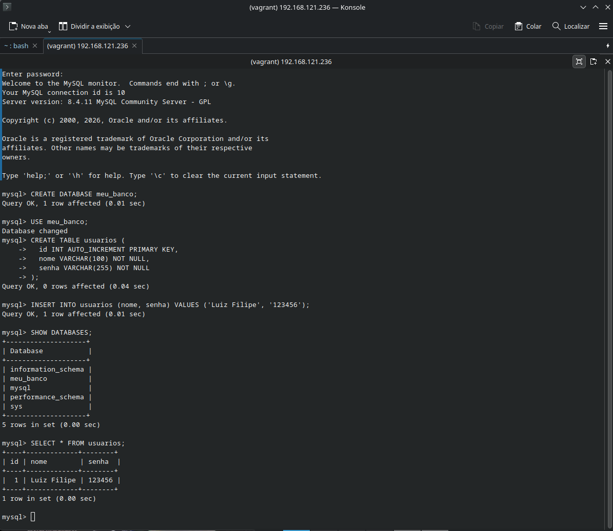
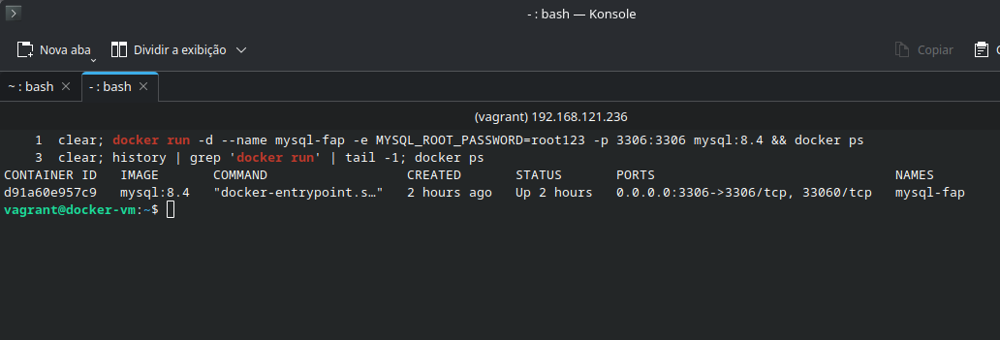
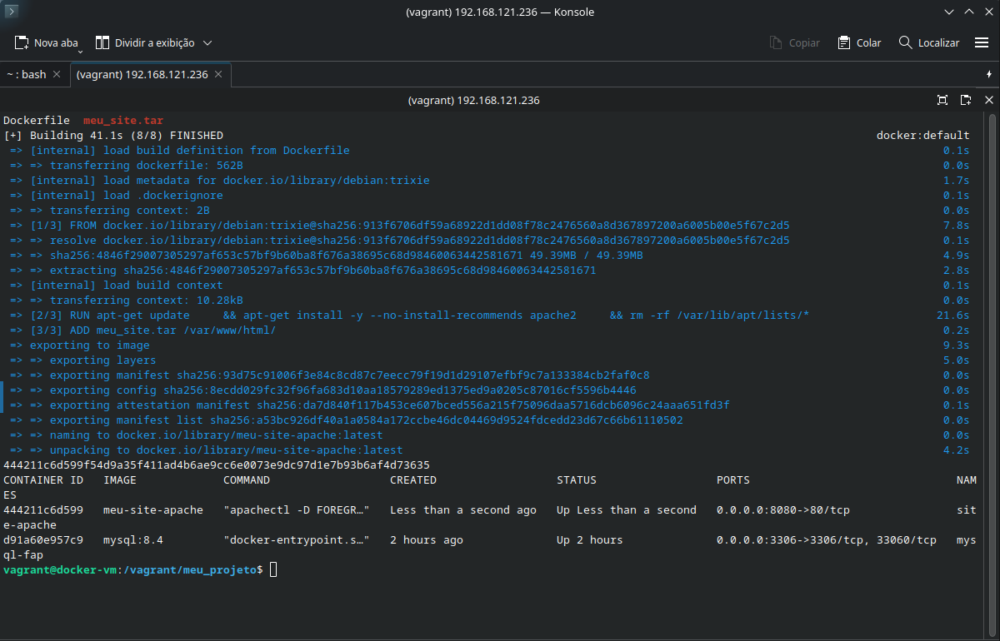
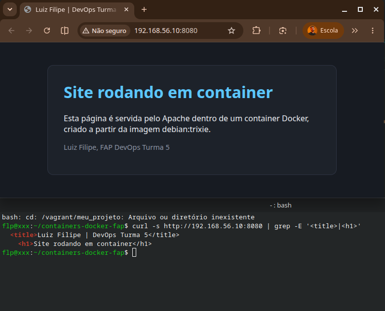

# Containers Docker: MySQL e Apache

Atividades da Unidade 9 (Docker) do curso de DevOps da FAP, Turma 5 (Aponti / CESAR School).

Fiz as duas atividades dentro de uma VM criada com Vagrant (Ubuntu 22.04, 2 GB de RAM, 1 CPU). O Docker é instalado na VM por um script de provisionamento.

## Estrutura

    .
    ├── Vagrantfile              VM com 2 GB, 1 CPU e IP 192.168.56.10
    ├── scripts/setup-docker.sh  instala o Docker na VM
    ├── site/                    código do site (index.html e style.css)
    ├── meu_projeto/
    │   ├── Dockerfile           Debian trixie + Apache
    │   └── meu_site.tar         site compactado, extraído pelo ADD
    └── evidencias/              prints da execução

## Como subir a VM

    vagrant up
    vagrant ssh

O Vagrantfile usa o provider libvirt (KVM), porque meu host é Fedora.

## Atividade 1: container MySQL

Dentro da VM:

    docker run -d --name mysql-fap -e MYSQL_ROOT_PASSWORD=root123 -p 3306:3306 mysql:8.4
    docker exec -it mysql-fap mysql -uroot -p

No cliente MySQL:

    CREATE DATABASE meu_banco;
    USE meu_banco;
    CREATE TABLE usuarios (
      id INT AUTO_INCREMENT PRIMARY KEY,
      nome VARCHAR(100) NOT NULL,
      senha VARCHAR(255) NOT NULL
    );
    INSERT INTO usuarios (nome, senha) VALUES ('Luiz Filipe', '123456');
    SELECT * FROM usuarios;

A senha do root é só para este laboratório.

## Atividade 2: site com Apache em container

No host, gero o .tar a partir da pasta do site e envio para a VM:

    tar -cf meu_projeto/meu_site.tar -C site .
    vagrant rsync

Dentro da VM:

    cd /vagrant/meu_projeto
    docker build -t meu-site-apache .
    docker run -d --name site-apache -p 8080:80 meu-site-apache

O site fica em http://192.168.56.10:8080

